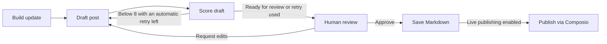

# LinkedIn Post Agent

Turn a short engineering update into a LinkedIn post you can review, revise, and approve from the terminal. LangGraph manages the workflow, OpenRouter powers drafting and critique, SQLite saves progress between runs, and Composio handles optional LinkedIn publishing.



## Quick start

From the repository root, create a Python virtual environment and install the dependencies.

```sh
python3 -m venv .venv
source .venv/bin/activate
python -m pip install langgraph langgraph-checkpoint-sqlite langchain-openai composio pydantic python-dotenv
```

Create a local `.env` file with your OpenRouter key. Git ignores this file.

```dotenv
OPENROUTER_API_KEY=replace_with_your_openrouter_key
OPENROUTER_MODEL=openrouter/free
LINKEDIN_DRY_RUN=true
```

```sh
python linkedin_post_agent.py
```

Enter a thread ID and describe what you built or learned in one to three sentences. For example, “I moved image resizing into a background worker so uploads could return sooner. The trade-off was adding a way for users to see when their images were ready.”

At the review prompt, enter **a** to approve, **e** to request edits, or **q** to pause. Run the script again with the same thread ID to resume a paused review. Use a fresh thread ID for each new post.

Dry run is the default. Approval saves a timestamped Markdown file under `approved_posts/`. The script stores checkpoints in `agent_state.db` in your working directory.

## Publish to LinkedIn

Add these settings to your local `.env` file.

```dotenv
COMPOSIO_API_KEY=replace_with_your_composio_key
COMPOSIO_USER_ID=your-composio-user-id
```

Connect your LinkedIn account once. Open the authorization URL printed by the script and complete the sign-in.

```sh
python linkedin_post_agent.py --connect
```

Run with live publishing enabled when you’re ready. Approving a draft archives it locally and submits it as a **public** LinkedIn post.

```sh
LINKEDIN_DRY_RUN=false python linkedin_post_agent.py
```

Use the same `COMPOSIO_USER_ID` for authorization and publishing. If the profile lookup fails, set `LINKEDIN_AUTHOR_URN` to your person URN, such as `urn:li:person:<your_id>`. Check LinkedIn before retrying an interrupted live publish to avoid posting twice.
